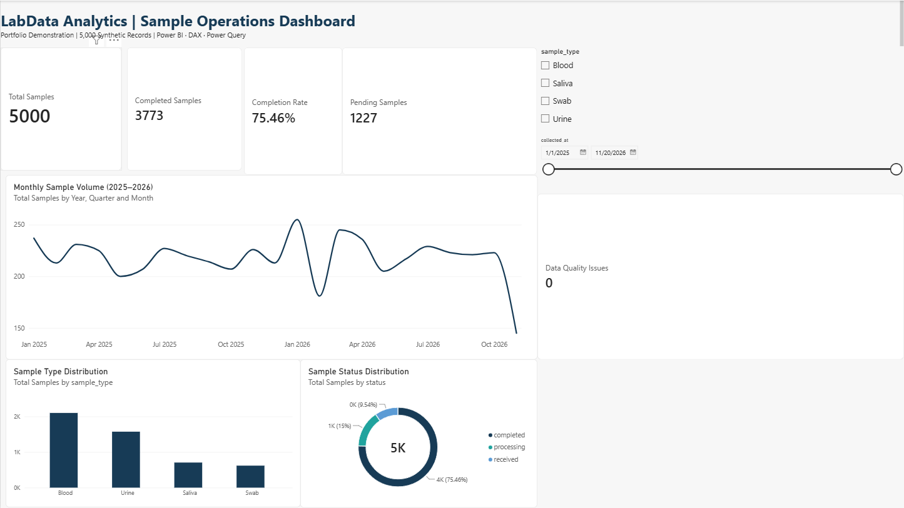

# LabData Analytics

[](https://github.com/Bochum0913/LabData-Analytics/actions/workflows/python-tests.yml)

A Python-based laboratory sample management and data quality API built with **FastAPI, Pandas, SQLAlchemy, SQLite, Pytest, and Docker**. This portfolio project demonstrates laboratory sample tracking, structured data validation, transactional CSV imports, API testing, and containerized deployment.

> **Educational demonstration only:** All provided sample records are synthetic. The application is not a clinical-grade LIMS and must not be used with real patient data.

## Features

- **Sample tracking:** Create, retrieve, filter, and update laboratory sample records.
- **Persistent storage:** Store samples in SQLite through SQLAlchemy, with initial data seeded from a synthetic CSV file only when the database is empty.
- **CSV batch imports:** Parse CSV files with Pandas and validate required fields, identifiers, dates, statuses, and numeric values before database insertion.
- **Atomic validation:** Reject invalid or duplicate imports without partially writing the batch.
- **Operational summaries:** Count samples by processing status.
- **API documentation:** Test endpoints through FastAPI's interactive Swagger UI.
- **Automated tests:** Run eight Pytest checks locally and through GitHub Actions.
- **Docker deployment:** Launch the API with Docker Compose and retain SQLite data in a named volume.

## Technology stack

| Area | Tools |
| --- | --- |
| API | Python, FastAPI, Pydantic |
| Data processing | Pandas |
| Persistence | SQLAlchemy, SQLite |
| Testing | Pytest, HTTPX |
| Automation | GitHub Actions |
| Deployment | Docker, Docker Compose |

## Quick start with Docker

**Prerequisite:** Docker Desktop or another Docker Engine with Compose support.

```bash
git clone https://github.com/Bochum0913/LabData-Analytics.git
cd LabData-Analytics
docker compose up --build -d
```

Open **http://127.0.0.1:8001/docs** to explore the API.

```bash
docker compose ps
docker compose logs -f
docker compose down
```

Docker Compose maps host port **8001** to container port **8000** and stores the SQLite database in a named Docker volume. `docker compose down` retains the data; `docker compose down -v` removes the volume and can erase stored records.

## Run locally (Windows PowerShell)

**Prerequisite:** Python 3.11+.

```powershell
py -m venv .venv
.\.venv\Scripts\python.exe -m pip install -r requirements.txt
.\.venv\Scripts\python.exe -m uvicorn main:app --reload
```

Open **http://127.0.0.1:8000/docs**. The local SQLite file is created under `data/` and is excluded from Git.

## API endpoints

| Method | Endpoint | Purpose |
| --- | --- | --- |
| GET | `/` | API information |
| GET | `/samples` | List samples, optionally filter by `status` |
| GET | `/samples/{sample_id}` | Retrieve one sample |
| POST | `/samples` | Create a sample |
| PATCH | `/samples/{sample_id}` | Update sample status or result |
| GET | `/summary` | Counts by sample status |
| POST | `/samples/import-csv` | Upload and validate a CSV batch |

### Example: create a sample

`POST /samples`

```json
{
  "sample_id": "LAB-009",
  "sample_type": "Urine",
  "collected_at": "2026-11-19",
  "status": "received",
  "result_value": null
}
```

Supported statuses: `received`, `processing`, and `completed`.

### Example: update a sample

`PATCH /samples/LAB-009`

```json
{
  "status": "completed",
  "result_value": 5.8
}
```

### CSV import format

Required headers:

```csv
sample_id,sample_type,collected_at,status,result_value
LAB-010,Blood,2026-11-19,received,
LAB-011,Urine,2026-11-19,completed,5.4
```

Use the `/samples/import-csv` endpoint in Swagger UI. Uploads must be UTF-8 CSV files, no larger than **1 MiB** or **500 data rows** per import. Duplicate sample IDs and invalid values are rejected with helpful error responses; a failed batch is not partially imported.

## Tests and continuous integration

Install development dependencies and run tests:

```powershell
.\.venv\Scripts\python.exe -m pip install -r requirements-dev.txt
.\.venv\Scripts\python.exe -m pytest -q
```

GitHub Actions runs the Python tests for pushes and pull requests. Check the [workflow results](https://github.com/Bochum0913/LabData-Analytics/actions).

## Project structure

```text
LabData-Analytics/
├── .github/workflows/python-tests.yml
├── data/samples.csv
├── tests/
├── .dockerignore
├── .gitignore
├── Dockerfile
├── compose.yaml
├── main.py
├── README.md
├── requirements.txt
└── requirements-dev.txt
```

## Scope and limitations

This is a portfolio project built to practice Python backend development and laboratory informatics concepts. It uses **synthetic data only** and does not provide production access control, audit trails, regulatory validation, or clinical interoperability certification.

## Power BI — Sample Operations Dashboard

An interactive Power BI dashboard built as an extension of my LabData Analytics portfolio project, demonstrating data transformation, visualization, DAX measures, and data quality validation.

### Dashboard Preview



### Key Features

- **Sample Monitoring:** Track total, completed, and pending samples.
- **Completion Rate:** Calculate sample processing performance using DAX.
- **Monthly Trends:** Analyze sample volume across 2025–2026.
- **Sample Type Analysis:** Compare Blood, Urine, Saliva, and Swab categories.
- **Status Distribution:** Visualize completed, processing, and received samples.
- **Interactive Filtering:** Filter reports by sample type and collection date.
- **Data Quality Validation:** Identify inconsistent records where completed samples lack results or incomplete samples contain results.

### Dataset

The dashboard uses **5,000 synthetic laboratory sample records** created solely for demonstration purposes.

No real patient information or clinical data is included. The dataset is not intended for medical interpretation.

### Technologies

- Microsoft Power BI Desktop
- Power Query
- DAX
- CSV data preparation and validation

### Example Results

| Metric | Value |
|---|---:|
| Total Samples | 5,000 |
| Completed Samples | 3,773 |
| Pending Samples | 1,227 |
| Completion Rate | 75.46% |
| Data Quality Issues | 0 |

The final collection month is incomplete and should not be interpreted as a full-month decline in sample volume.

### How to Open

1. Download `PowerBI/LabData_Analytics_Dashboard.pbix`.
2. Open it using Microsoft Power BI Desktop.
3. Use the sample type and date range slicers to explore the dashboard.
4. To refresh the source data, update the CSV file path in Power Query if necessary.

**Note:** This is an independent portfolio demonstration, not a production healthcare reporting system.